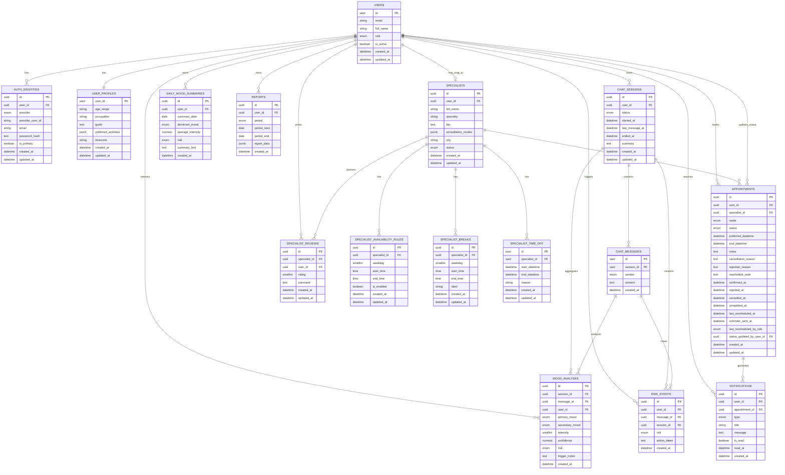

# Mental Health Assistant ERD

Diagrama de mai jos descrie structura actuala a principalelor entitati din backend si relatiile dintre ele.

## Observatii

- `users` este entitatea centrala pentru autentificare, chat, rapoarte, programari si notificari.
- `specialists.user_id` este optional, dar unic; permite maparea unui cont de utilizator la un profil de specialist.
- `user_profiles.user_id` este simultan cheie primara si cheie externa catre `users.id`, deci relatia este 1 la 1.
- `appointments.status_updated_by_user_id` leaga o modificare de status de un utilizator, separat de utilizatorul care a facut programarea.
- `risk_events.session_id` este optional, deoarece un eveniment de risc poate fi legat direct de mesaj, chiar daca sesiunea nu mai este activa.

## Cum il poti vizualiza

- In GitHub sau in editoare cu suport Mermaid, fisierul se randareaza direct.
- In VS Code poti folosi o extensie Mermaid Preview.
- Daca vrei, il pot converti si intr-un SVG sau PNG pentru documentatie/prezentare.
